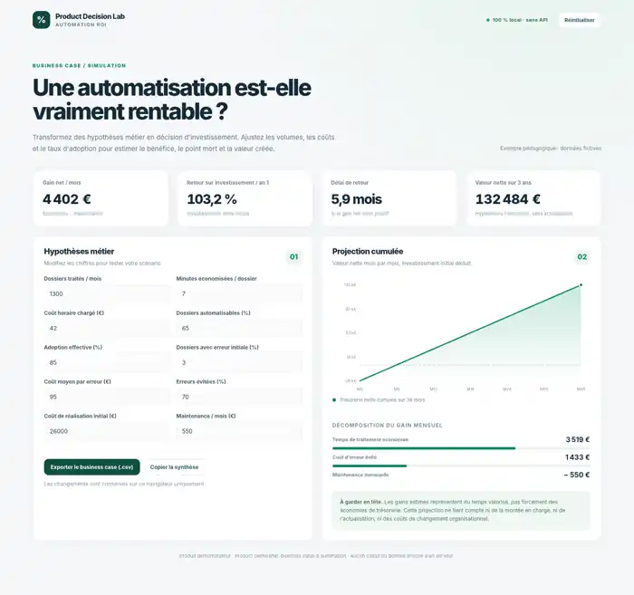

# Automation ROI Calculator

**A compact, transparent business-case tool for Product Owners evaluating process automation.**

This static web app estimates the financial value of automating a recurring business workflow. It is designed to make assumptions explicit and challengeable during a discovery workshop, not to replace a financial model.



## Problem → product response

A team proposes automating a manual workflow. Stakeholders agree the idea sounds useful but have no shared answer to the questions: *How much capacity could this save? What adoption rate is realistic? When would investment pay back?*

The calculator turns those assumptions into four decision indicators: **monthly net benefit, year-one ROI, break-even time, and 36-month net value**, plus a cumulative chart and exportable CSV business case.

## Live demo / run locally

- **Live demo:** once GitHub Pages is enabled, `https://goldaj.github.io/product-roi-calculator/`.
- **Offline:** download this repository and double-click `index.html`. No server, dependencies, accounts, API keys, or installation required.
- **Unit tests (optional):** `node tests.js` (Node.js 18+).

## Model and assumptions

```text
Eligible cases / month = case volume × automation coverage × actual adoption
Time value / month    = eligible cases × minutes saved / 60 × fully-loaded hourly cost
Error value / month   = eligible cases × baseline error rate × error reduction × cost per error
Gross benefit / month = time value + error value
Net benefit / month   = gross benefit − recurring maintenance
Year-one ROI          = ((12 × net monthly benefit − one-time build cost) / build cost) × 100
Break-even (months)   = build cost / net monthly benefit, if net monthly benefit > 0
36-month net value    = 36 × net monthly benefit − one-time build cost
```

Automation coverage and adoption are both applied to the eligible volume. Percentages are capped at 100%. The time and error savings are simplified monetized estimates, **not guaranteed cash savings**; year-one ROI is undefined if upfront investment is zero, and break-even cannot be reached when monthly net benefit is not positive.

Excluded intentionally: ramp-up curves, discount rates, opportunity costs, capacity reinvestment, change management, and benefit overlap across unrelated processes. Those are worthwhile next iterations once a real stakeholder validates the model.

## Product thinking

- **Target users:** Product Owner, Operations Manager, Finance Business Partner.
- **Decision to support:** Should an automation opportunity proceed to detailed discovery?
- **Value hypothesis:** Better input transparency produces faster, more defensible go/no-go conversations.
- **Success metrics to validate:** share of decisions with quantified assumptions; time to prepare a business case; stakeholder confidence in sensitivity discussions.
- **Scope trade-off:** local-only, deterministic calculations instead of authentication, backend, integrations, or speculative AI-generated forecasts.

## How to review

1. Increase automation coverage and watch the break-even time fall.
2. Reduce adoption below 20% to challenge optimistic benefits.
3. Increase ongoing maintenance to see when the projected ROI turns negative.
4. Export the CSV for a stakeholder workshop.

## Privacy and disclaimer

All sample figures are fictional. The browser stores scenario inputs in `localStorage`. Data never leaves the page. This is an educational financial estimation tool and does not constitute investment or financial advice.

## Technologies

HTML, CSS, vanilla JavaScript, SVG charts, browser localStorage. No external libraries. MIT license.

**Portfolio context:** Product ownership, automation, business-case reasoning, and insurance operations domain experience.

## Status and limits

This is an implemented portfolio prototype: the repository includes the static calculator, deterministic financial-estimation logic, fictional inputs, a screenshot, and an automated test script. Its outputs depend on the supplied assumptions and the simplified model above; they do not establish realized savings or a validated investment decision. No real-stakeholder validation study or production deployment evidence is included.
